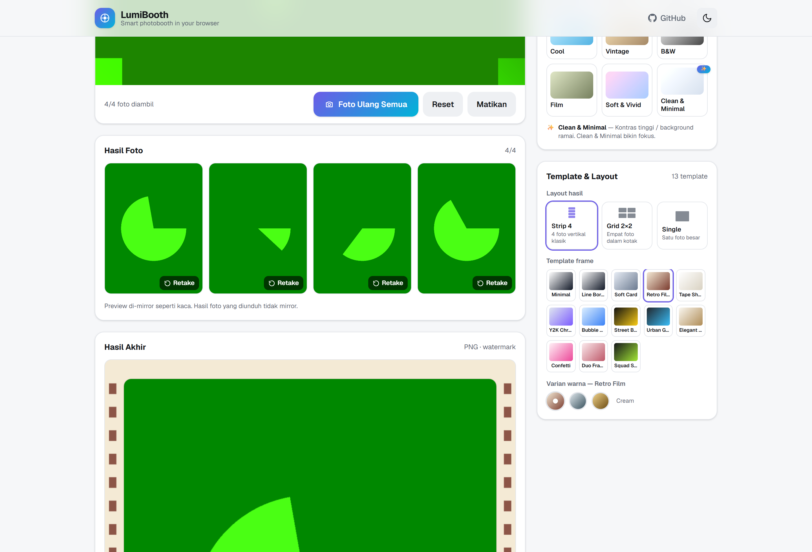
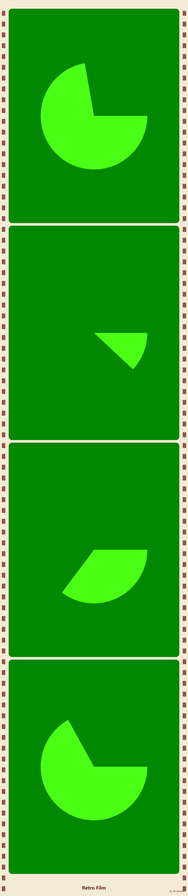

# 📸 LumiBooth

**Photo booth pintar di browser** — ambil 4 foto otomatis dengan countdown, deteksi cahaya real-time, filter cerdas yang direkomendasikan otomatis, 13 template frame, dan hasil akhir PNG beresolusi tinggi lengkap dengan watermark.

Semua diproses **100% lokal di perangkatmu** — tidak ada foto yang di-upload ke server.


---

## ✨ Fitur

### Tahap 1 — Kamera & Auto HD
- **Auto-HD**: memilih resolusi tertinggi yang didukung perangkat (1080p → 720p → 480p, fallback otomatis).
- Indikator resolusi real-time (dibaca dari `track.getSettings()`).
- Toggle manual **Auto HD / Full HD / HD**.
- Preview **mirror** seperti cermin, hasil foto **tidak** mirror.
- **Countdown 3 detik** otomatis untuk 4 foto berurutan.
- **Retake per foto** — ulangi hanya slot yang kurang pas.

### Tahap 2 — Deteksi Cahaya & Filter Cerdas
- Analisis frame kamera tiap ~1 detik (sampel 64×48 px):
  - **Brightness** (luminance Rec.601)
  - **Contrast** (standar deviasi luminance)
  - **Colorfulness** (Hasler–Süsstrunk)
  - **Color Temperature** (warm/cool, ternormalisasi ±1)
- Klasifikasi kondisi: `Gelap`, `Terang`, `Netral`, `Hangat`, `Dingin`, `Kontras Tinggi`, `Ramaikan`.
- **Rekomendasi filter otomatis** dengan badge `✨ Recommended` + alasan singkat.
- 9 filter: Normal, Bright, Warm, Cool, Vintage, B&W, Film, Soft & Vivid, Clean & Minimal.
- Filter diterapkan konsisten di preview (CSS) **dan** saat capture (`ctx.filter`).

### Tahap 3 — Template & Layout
- **13 template frame**, gender-neutral, dikelompokkan per kategori:
  Minimal · Retro · Y2K · Street · Elegant · Playful · Couple · Squad.
- **3 varian warna** untuk setiap template (39 palet total).
- 8 jenis dekorasi frame: `none`, `corners`, `dots`, `stripes`, `film`, `confetti`, `grid`, `tape`.
- **3 layout hasil**: Strip 4 (vertikal klasik), Grid 2×2, Single (satu foto besar).

### Tahap 4 — Render Akhir & Watermark
- Komposisi canvas 2D native: frame + dekorasi + foto (cover-crop, sudut membulat) + caption.
- **Watermark `by @ruelzexe`** di pojok kanan bawah, 13px, opacity 60%.
- **Warna watermark adaptif**: otomatis hitam bila area di bawahnya terang (brightness > 140), putih bila gelap — selalu terbaca.
- Preview hasil akhir **live** saat template/layout/warna diganti.
- **Download PNG** kualitas tinggi (render penuh, bukan screenshot).

---

## 🖼️ Tangkapan Layar

| Deteksi cahaya & filter | Hasil akhir |
| --- | --- |
|  |  |

Contoh hasil render (strip 4, template Retro Film):



---

## 🚀 Jalankan Lokal

```bash
# 1. Install dependency
npm install

# 2. Jalankan dev server
npm run dev

# Buka http://localhost:3000
```

> ⚠️ **Kamera butuh secure context.** `getUserMedia` hanya berjalan di `https://`
> atau `http://localhost`. Mengakses lewat IP LAN biasa (`http://192.168.x.x`)
> akan ditolak browser.

### Build produksi

```bash
npm run build
npm run start
```

---

## 🧪 Pengujian

| Perintah | Cakupan |
| --- | --- |
| `npm run test:lighting` | 7 skenario klasifikasi cahaya → rekomendasi filter |
| `npm run test:templates` | 13 template, ≥3 varian unik, 3 layout |
| `npm run test:e2e` | E2E browser (Playwright + fake webcam): capture 4 foto, render akhir, watermark, switch layout |

E2E memerlukan Chromium:

```bash
npx playwright install chromium
npm run build && npm run start   # di terminal lain
node scripts/e2e.cjs
```

Regenerasi screenshot: `node scripts/screenshots.cjs` (menulis ke `docs/`).

---

## 🛠️ Teknologi

- **Next.js 16.4** (App Router, Turbopack, Cache Components)
- **React 19.3**
- **Tailwind CSS v4**
- **TypeScript** (strict)
- Canvas 2D API & MediaStream API — tanpa library gambar eksternal

### Struktur

```
src/
├── app/                    # layout, page, globals.css
├── components/
│   ├── Photobooth.tsx      # orkestrator utama
│   ├── LightingIndicator.tsx
│   ├── FilterPanel.tsx
│   ├── TemplatePanel.tsx   # template + varian warna + layout
│   ├── ResultCard.tsx      # preview akhir + download
│   ├── ui.tsx              # Card, Button, Badge
│   ├── Header.tsx / Footer.tsx / ThemeToggle.tsx
├── hooks/
│   ├── useCamera.ts        # auto-HD fallback chain
│   ├── useCountdown.ts
│   └── useLighting.ts      # sampling frame → metrik
└── lib/
    ├── lighting.ts         # metrik & threshold
    ├── recommendations.ts  # rules engine
    ├── filters.ts          # 9 filter
    ├── templates.ts        # 13 template × 3 varian, 3 layout
    ├── render.ts           # compositing canvas + watermark
    ├── capture.ts          # snapshot video → dataURL
    ├── config.ts           # konstanta (watermark, jumlah foto)
    └── types.ts
```

---

## ☁️ Deploy

### Vercel (rekomendasi)

1. Import repo ini di [vercel.com/new](https://vercel.com/new).
2. Framework terdeteksi otomatis (**Next.js**) — tanpa konfigurasi tambahan.
3. Deploy. HTTPS disediakan otomatis sehingga kamera langsung berfungsi.

Atau via CLI:

```bash
npx vercel --prod
```

### Catatan untuk hosting statis

LumiBooth adalah aplikasi client-side penuh, jadi bisa di-export statis:

```ts
// next.config.ts
export default { output: "export" };
```

Lalu `npm run build` menghasilkan folder `out/` yang bisa di-host di GitHub Pages,
Netlify, Cloudflare Pages, dan sejenisnya. Pastikan host memakai **HTTPS**.

---

## 👤 Kredit

**Built by [@ruelzexe](https://github.com/ruelzexe)**

Setiap hasil foto otomatis diberi watermark `by @ruelzexe`.

---

## 📄 Lisensi

MIT
