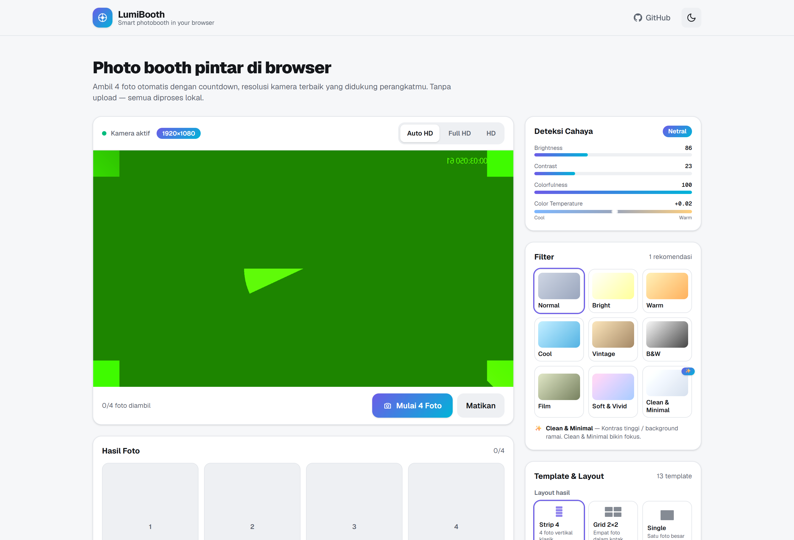
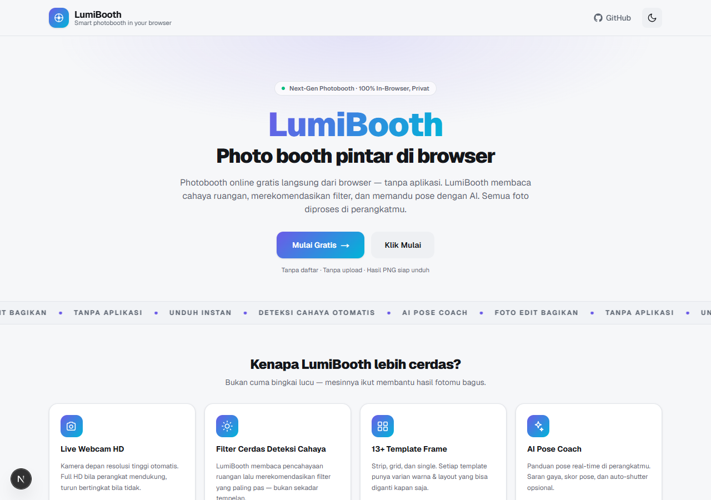
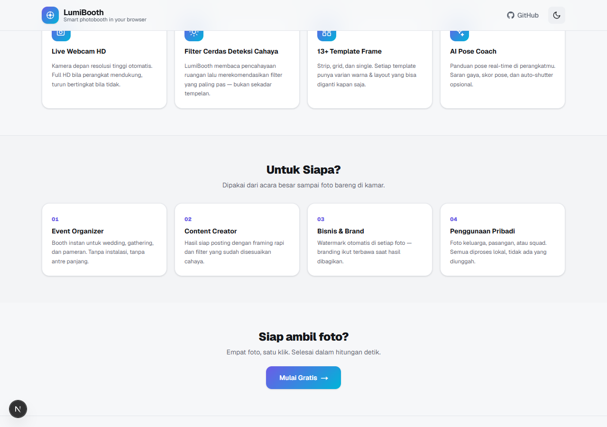
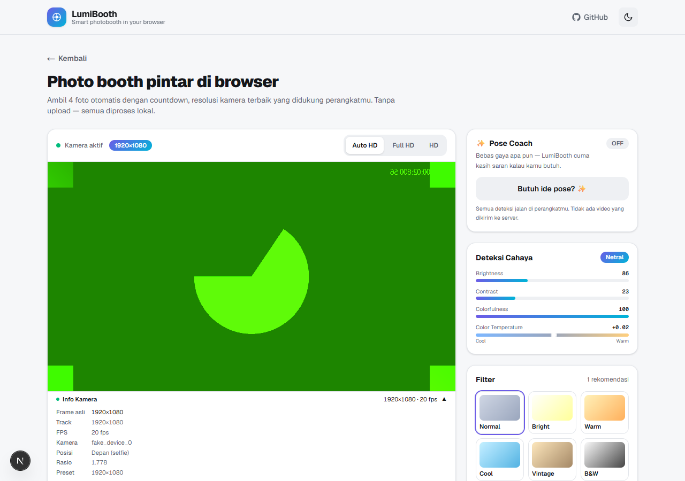
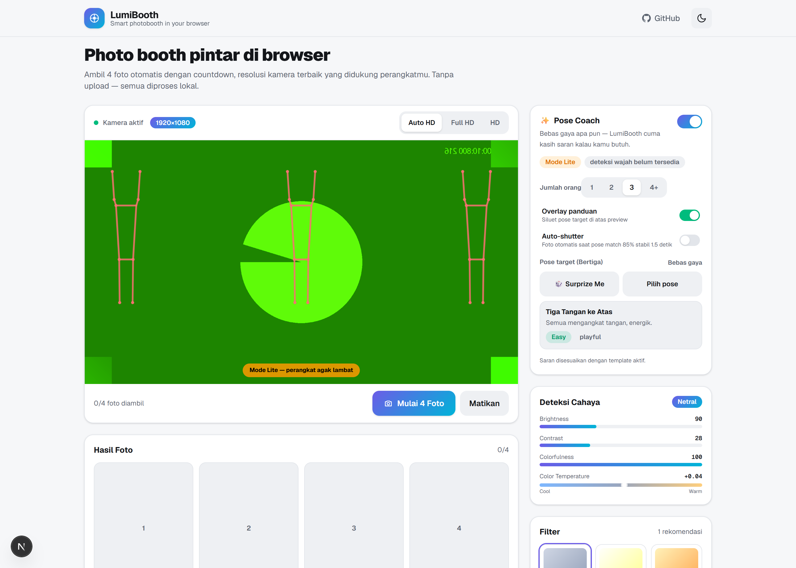

# 📸 LumiBooth

**Photo booth pintar di browser** — ambil 4 foto otomatis dengan countdown, deteksi cahaya real-time, filter cerdas yang direkomendasikan otomatis, 13 template frame, dan hasil akhir PNG beresolusi tinggi lengkap dengan watermark.

Semua diproses **100% lokal di perangkatmu** — tidak ada foto yang di-upload ke server.

### 🔗 [**Buka demo →**](https://nasrulaja.github.io/LumiBooth/)



---

## ✨ Fitur

### Landing page — "Next-Gen Photobooth"
- **Landing dulu, kamera belakangan** — tidak ada prompt izin sebelum user klik **Mulai Gratis**.
- Hero besar, **marquee berjalan** (`FOTO EDIT BAGIKAN • TANPA APLIKASI • UNDUH INSTAN …`).
- 4 kartu fitur + badge **100% In-Browser, Privat**, section **"Untuk Siapa?"** (Event Organizer, Content Creator, Bisnis & Brand, Penggunaan Pribadi).
- Tombol **← Kembali** di halaman booth.
- Posisi produk sengaja dibedakan dari funcam: bukan sekadar penjual frame, tapi photobooth yang **cerdas** (deteksi cahaya + rekomendasi filter + AI Pose Coach).

### Tahap 1 — Kamera & Auto HD
- **Auto-HD**: memilih resolusi tertinggi yang didukung perangkat (1080p → 720p → 480p → 640×480, fallback bertingkat).
- `getUserMedia` meminta resolusi tinggi eksplisit (`width/height ideal`) + `facingMode: "user"` (kamera depan untuk selfie).
- Indikator resolusi real-time (dibaca dari `track.getSettings()`).
- **Panel "Info Kamera"** — resolusi aktual, fps, label perangkat, facingMode, rasio, preset yang dipakai.
- **Preview WYSIWYG & tajam**: kotak preview mengikuti rasio asli kamera (tidak dipaksa 4:3/16:9) dan memakai `object-fit: contain`, jadi frame tidak di-zoom/ter-crop. Capture memotong dengan aturan **crop yang sama** (`computeCoverCrop`) → hasil PNG = yang dilihat di layar.
- Toggle manual **Auto HD / Full HD / HD**.
- Preview **mirror** seperti cermin, hasil foto **tidak** mirror.
- **Countdown 3 detik** otomatis untuk 4 foto berurutan.
- **Retake per foto** — ulangi hanya slot yang kurang pas.

### Tahap 2 — Deteksi Cahaya & Filter Cerdas
- Analisis frame kamera tiap ~1 detik (sampel 64×48 px):
  - **Brightness** (luminance Rec.601)
  - **Contrast** (standar deviasi luminance)
  - **Colorfulness** (Hasler–Süsstrunk)
  - **Color Temperature** (warm/cool, ternormalisasi ±1)
- Klasifikasi kondisi: `Gelap`, `Terang`, `Netral`, `Hangat`, `Dingin`, `Kontras Tinggi`, `Ramaikan`.
- **Rekomendasi filter otomatis** dengan badge `✨ Recommended` + alasan singkat.
- 9 filter: Normal, Bright, Warm, Cool, Vintage, B&W, Film, Soft & Vivid, Clean & Minimal.
- Filter diterapkan konsisten di preview (CSS) **dan** saat capture (`ctx.filter`).

### Tahap 3 — Template & Layout
- **13 template frame**, gender-neutral, dikelompokkan per kategori:
  Minimal · Retro · Y2K · Street · Elegant · Playful · Couple · Squad.
- **3 varian warna** untuk setiap template (39 palet total).
- 8 jenis dekorasi frame: `none`, `corners`, `dots`, `stripes`, `film`, `confetti`, `grid`, `tape`.
- **3 layout hasil**: Strip 4 (vertikal klasik), Grid 2×2, Single (satu foto besar).

### Tahap 4 — Render Akhir & Watermark
- Komposisi canvas 2D native: frame + dekorasi + foto (cover-crop, sudut membulat) + caption.
- **Watermark `by @ruelzexe`** di pojok kanan bawah, 13px, opacity 60%.
- **Warna watermark adaptif**: otomatis hitam bila area di bawahnya terang (brightness > 140), putih bila gelap — selalu terbaca.
- Preview hasil akhir **live** saat template/layout/warna diganti.
- **Download PNG** kualitas tinggi (render penuh, bukan screenshot).

### Tahap 5 — AI Pose Coach (suggestif, bukan memaksa)

Pendamping pose yang **opsional dan default OFF**. Kamu bebas foto gaya apa pun — coach cuma bantu kalau kamu minta.

> _"Bebas gaya apa pun — LumiBooth cuma kasih saran kalau kamu butuh."_

- **Deteksi real-time 100% on-device.** TensorFlow.js **MoveNet MultiPose** (skeleton: bahu, siku, pergelangan, pinggul, lutut) + **BlazeFace** (hitung wajah). Tidak ada frame yang dikirim ke server — hanya bobot model yang diunduh sekali lalu di-cache browser.
- **Skor kemiripan pose** memakai **cosine similarity** antar keypoint, tampil live sebagai progress bar **merah → kuning → hijau**. Skor hanyalah informasi — **tidak pernah memblokir foto**.
- **Coaching text** muncul **hanya** kalau kamu memilih pose target dan skor < 70%. Instruksi singkat & spesifik (maks. 8 kata, contoh: _"Turunkan tangan kiri"_), update tiap ±500 ms, dan **diam kalau kamu abaikan** (anti-spam).
- **Overlay siluet skeleton** pose target yang **adaptif** — ikut meregang & bergeser mengikuti posisi tubuhmu. Bisa dimatikan sendiri.
- **Auto-shutter opsional (default OFF)**: foto otomatis saat pose match ≥ 85% dan stabil 1.5 detik. Tombol shutter manual **selalu** tersedia dan bekerja kapan pun.
- **Expression check non-blocking**: notif kecil _"ada yang belum senyum nih"_ yang hilang sendiri. Tidak ada syarat senyum.
- **Pose library 62 pose** — 17 solo, 15 couple, 15 trio, 15 squad. Tiap pose punya judul, deskripsi, data keypoint, tingkat kesulitan (Easy/Medium), dan tag vibe (elegan/playful/street/y2k). Rekomendasi mengikuti template aktif.
- **Anti-kaku**: setelah 2 foto beruntun pose jempol/peace, muncul **satu** saran alternatif yang bisa di-dismiss. Tidak pernah mencegahmu memakai pose itu lagi.
- **🎲 Surprize Me**: pilihkan pose acak sesuai jumlah orang + template, tampilkan brief 3 detik, lalu coaching mulai.
- **Fallback aman**: kalau perangkat lemah (< 15 fps) otomatis turun ke **Mode Lite** (BlazeFace + overlay statis) dengan notif kecil. Kalau model gagal dimuat, app tetap jalan penuh untuk foto biasa + dropdown jumlah orang manual.


---

## 🖼️ Tangkapan Layar

| Landing (hero + marquee) | Fitur & "Untuk Siapa?" |
| --- | --- |
|  |  |

| Booth + panel Info Kamera | Deteksi cahaya & filter |
| --- | --- |
|  |  |

| Hasil akhir | AI Pose Coach |
| --- | --- |
|  |  |

Contoh hasil render (strip 4, template Retro Film):


---

## 🚀 Jalankan Lokal

```bash
# 1. Install dependency
npm install

# 2. Jalankan dev server
npm run dev

# Buka http://localhost:3000
```

> ⚠️ **Kamera butuh secure context.** `getUserMedia` hanya berjalan di `https://`
> atau `http://localhost`. Mengakses lewat IP LAN biasa (`http://192.168.x.x`)
> akan ditolak browser.

### Build produksi

```bash
npm run build
npm run start
```

---

## 🧪 Pengujian

| Perintah | Cakupan |
| --- | --- |
| `npm run test:lighting` | 7 skenario klasifikasi cahaya → rekomendasi filter |
| `npm run test:templates` | 13 template, ≥3 varian unik, 3 layout |
| `npm run test:pose` | Pose Coach: cosine matching, coaching (≤8 kata), auto-shutter (default OFF, 85%/1.5s), 62 pose library, 3 skenario wajib |
| `npm run test:e2e:landing` | Landing page: hero, marquee berjalan, 4 kartu fitur, "Untuk Siapa?", footer credit, kamera belum aktif sebelum klik Mulai, tombol Kembali |
| `npm run test:capture` | Kualitas hasil: PNG tidak di-upscale, ≥1280px, dan rasio PNG = rasio preview (WYSIWYG) |
| `npm run test:e2e` | E2E browser (Playwright + fake webcam): capture 4 foto, render akhir, watermark, switch layout |
| `npm run test:e2e:pose` | E2E Pose Coach: default OFF, tagline, toggle overlay/auto-shutter, pilih pose, Surprize Me, shutter manual tetap jalan |
| `npm run test:model` | Verifikasi MoveNet + BlazeFace benar-benar termuat & siap di browser |
| `npm run test:pages` | Smoke test hasil static export (base path, aset, alur capture) |

E2E memerlukan Chromium:

```bash
npx playwright install chromium
npm run build && npm run start   # di terminal lain
node scripts/e2e.cjs
```

Regenerasi screenshot: `node scripts/screenshots.cjs` (menulis ke `docs/`).

---

## 🛠️ Teknologi

- **Next.js 16.4** (App Router, Turbopack, Cache Components)
- **React 19.3**
- **Tailwind CSS v4**
- **TypeScript** (strict)
- **TensorFlow.js** — MoveNet MultiPose + BlazeFace (Pose Coach, on-device)
- Canvas 2D API & MediaStream API — tanpa library gambar eksternal

### Struktur

```
src/
├── app/                    # layout, page, globals.css
├── components/
│   ├── Landing.tsx         # landing page (hero, fitur, "Untuk Siapa?")
│   ├── Marquee.tsx         # teks berjalan tanpa henti
│   ├── Photobooth.tsx      # orkestrator utama
│   ├── CameraInfoPanel.tsx # panel debug resolusi/fps/label kamera
│   ├── LightingIndicator.tsx
│   ├── FilterPanel.tsx
│   ├── TemplatePanel.tsx   # template + varian warna + layout
│   ├── ResultCard.tsx      # preview akhir + download
│   ├── PoseCoachPanel.tsx  # kontrol Pose Coach (default OFF)
│   ├── PoseCoachHud.tsx    # skor, coaching, notif di atas preview
│   ├── PoseCoachToggleRow.tsx
│   ├── ui.tsx              # Card, Button, Badge
│   ├── Header.tsx / Footer.tsx / ThemeToggle.tsx
├── data/
│   └── poses.json          # 62 pose (generated — jangan edit manual)
├── hooks/
│   ├── useCamera.ts        # auto-HD fallback chain + info kamera aktual
│   ├── useCountdown.ts
│   ├── useLighting.ts      # sampling frame → metrik
│   └── usePoseCoach.ts     # loop deteksi, skor, coaching, auto-shutter
└── lib/
    ├── lighting.ts         # metrik & threshold
    ├── recommendations.ts  # rules engine
    ├── filters.ts          # 9 filter
    ├── templates.ts        # 13 template × 3 varian, 3 layout
    ├── render.ts           # compositing canvas + watermark
    ├── capture.ts          # snapshot video → dataURL
    ├── config.ts           # konstanta (watermark, jumlah foto)
    ├── pose-coach-config.ts  # keypoint, threshold, tagline (mudah di-tweak)
    ├── pose-types.ts         # tipe data Pose Coach
    ├── pose-library.ts       # akses poses.json + rekomendasi
    ├── pose-matching.ts      # cosine similarity + skor per keypoint
    ├── pose-coaching.ts      # coaching text (maks 8 kata, anti-spam)
    ├── pose-autoshutter.ts   # state machine auto-shutter
    ├── pose-overlay.ts       # gambar skeleton adaptif
    ├── pose-gesture.ts       # heuristik peace/jempol (anti-kaku)
    ├── pose-detector.ts      # loader MoveNet + BlazeFace
    ├── empty-module.ts       # stub paket MediaPipe opsional
    └── types.ts
```

---

## ☁️ Deploy

### Vercel (rekomendasi)

1. Import repo ini di [vercel.com/new](https://vercel.com/new).
2. Framework terdeteksi otomatis (**Next.js**) — tanpa konfigurasi tambahan.
3. Deploy. HTTPS disediakan otomatis sehingga kamera langsung berfungsi.

Atau via CLI:

```bash
npx vercel --prod
```

### GitHub Pages (demo)

Repo ini sudah dilengkapi workflow `.github/workflows/pages.yml` yang otomatis
membangun static export dan men-deploy-nya setiap push ke `main`.

Build statis memakai `output: "export"` + `basePath: "/LumiBooth"` yang
diaktifkan hanya ketika env `GITHUB_PAGES=1` (lihat `next.config.ts`), sehingga
`npm run dev` dan deploy Vercel tetap berjalan normal.

Aktifkan sekali di **Settings → Pages → Build and deployment → Source: GitHub Actions**.
Setelah itu setiap push ke `main` akan memperbarui demo.

Untuk mencoba build statis secara lokal:

```bash
# Windows PowerShell
$env:GITHUB_PAGES="1"; npm run build; npx serve out
# macOS / Linux
GITHUB_PAGES=1 npm run build && npx serve out
```

---

## 👤 Kredit

**Built by [@ruelzexe](https://github.com/ruelzexe)**

Setiap hasil foto otomatis diberi watermark `by @ruelzexe`.

---

## 📄 Lisensi

MIT
